Fourth-year Computer Engineering student at Pontificia Universidad Católica de Valparaíso (PUCV) · Valparaíso, Chile

## About me

- Currently building **Studify**, an AI-powered adaptive learning platform and my thesis project, alongside a few side projects.
- Interested in AI/LLM-powered apps, RAG pipelines and full-stack development.
- Learning French and sharpening my programming skills by building several projects in parallel.
- Fun fact: when I'm not coding, I'm into photography, astronomy and video games.

## Featured projects

| Project | What it is | Stack |
|---|---|---|
| **[Studify](https://github.com/VicenteCLeon/Studify)** | VARK-tailored study capsules via a no-embeddings RAG (traceable SQL retrieval) with hallucinated-citation checks. Thesis project · co-authored with Vicente Cisternas | Python · FastAPI · HTMX PostgreSQL · DeepSeek |
| **[MARC-IA](https://github.com/PytricioPUCV/MARC-IA-Project)** | RAG-based virtual assistant for institutional guidance at PUCV, built on ChromaDB + Gemini. Team project · Team lead & full-stack dev (team of 5) | React · FastAPI · PostgreSQL · Docker |
| **[Racing Web](https://github.com/PytricioPUCV/Racing_Web_Ionic)** | E-commerce for a store inspired by racing culture. [Live demo](https://racing-web-ionic.vercel.app) Team project | Ionic · Angular · TypeScript · Docker |
| **[Decants del Puerto](https://github.com/PytricioPUCV/perfume-decants)** | Online store for perfume decants with a browser-side cart and WhatsApp checkout. [Live site](https://perfume-decants.vercel.app) | React · TypeScript · Vite · Tailwind |
| **[ACC Server Admin Panel](https://github.com/PytricioPUCV/ACC-Dedicated-Server-AdminPanel)** | Web admin panel and automatic track rotation for the Assetto Corsa Competizione dedicated server. | Python · JavaScript · PyInstaller |

**Other projects:** [PirateAdventures](https://github.com/PytricioPUCV/PirateAdventures), a 2D pirate game built in Java with LibGDX.

## Tech stack

**Languages** 

**Frameworks** 

**Data & infra** 

**Tools** 

## Outside of code

Photography with Lightroom and Photoshop · 3D in Blender · tinkering with Linux/Debian

## GitHub stats

<picture>
  <source media="(prefers-color-scheme: dark)" srcset="./assets/stats-dark.svg" />
  <source media="(prefers-color-scheme: light)" srcset="./assets/stats-light.svg" />
  
</picture>
<picture>
  <source media="(prefers-color-scheme: dark)" srcset="./assets/top-langs-dark.svg" />
  <source media="(prefers-color-scheme: light)" srcset="./assets/top-langs-light.svg" />
  
</picture>

<picture>
  <source media="(prefers-color-scheme: dark)" srcset="https://streak-stats.demolab.com?user=PytricioPUCV&theme=dark&hide_border=true" />
  <source media="(prefers-color-scheme: light)" srcset="https://streak-stats.demolab.com?user=PytricioPUCV&theme=default&hide_border=true" />
  
</picture>

<picture>
  <source media="(prefers-color-scheme: dark)" srcset="./assets/github-snake-dark.svg" />
  <source media="(prefers-color-scheme: light)" srcset="./assets/github-snake.svg" />
  
</picture>

